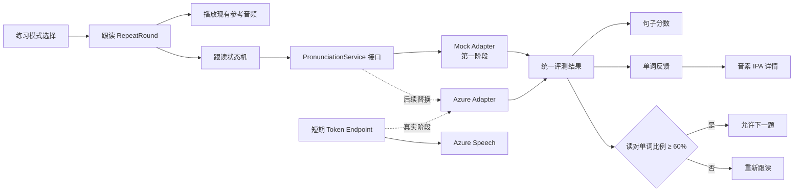
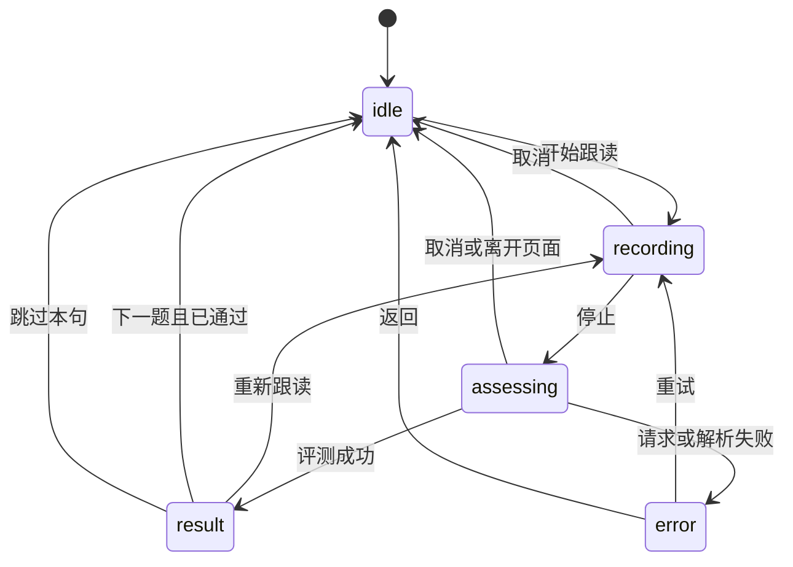

# Word Atlas 跟读与发音评测：架构分析和实现计划

> 状态：Phase 1 Mock UI 已完成；真实录音与 Azure 接入尚未开始
> 日期：2026-10-31
> 目标：先使用 Mock 数据完成并确认交互界面，再连接真实 Azure Pronunciation Assessment。

## 1. 请评审的内容

请重点检查以下方面：

1. Mock 优先、Azure 后接入的分层是否合理。
2. 60% 通关规则和单词正确判定是否清楚、可实现。
3. 浏览器录音、Azure Token、安全和隐私设计是否存在遗漏。
4. 异常状态、资源释放和移动端交互是否完整。
5. 文件与组件划分是否适合当前项目规模，是否有过度设计。

## 2. 功能目标

在 Word Atlas 的练习页面中增加第四种模式：**跟读**。

用户流程：

1. 查看现有词条中的英文例句和中文翻译。
2. 播放参考音频。
3. 点击麦克风按钮开始跟读。
4. 手动停止录音。
5. 等待发音评测。
6. 查看句子、单词和音素级反馈。
7. 读对至少 60% 的参考单词后进入下一题，否则重新跟读。

第一阶段只实现 Mock 交互，不连接麦克风、Azure 或其他网络服务。用户确认交互后，第二阶段再接入真实录音与 Azure。

## 3. 范围

### 3.1 MVP 包含

- 新增“跟读”练习模式。
- 播放现有参考音频。
- 明确的录音开始、手动停止和取消操作。
- 录音中、分析中、成功、失败和重试状态。
- 句子级总分、准确度、流利度和完整度。
- 单词级正确/错误反馈。
- 点击单词查看 IPA 音素及其分数。
- 读对单词比例达到 60% 后允许下一题。
- 安全配置和部署说明。
- 必要的测试、构建和隐私检查。

### 3.2 MVP 不包含

- Prosody 韵律评分。
- AI 生成的发音指导或教学建议。
- 练习历史和成绩趋势。
- 云端录音存储。
- 用户账号、多用户系统或管理后台。
- 与跟读功能无关的重构。

## 4. 当前项目分析

### 4.1 技术栈

- React 19
- TypeScript 5.9，严格模式
- Vite 6
- 静态前端部署
- 当前没有应用后端

### 4.2 现有练习结构

练习功能主要位于 `src/pages/Practice.tsx`：

- 当前有单词、句子和听写三种模式。
- 句子练习使用词条的第一个例句。
- 每轮最多选择 10 个词条。
- 所有现有模式最终进入输入型练习组件。

参考音频通过 `src/lib/audio.ts` 播放：

- 优先播放数据集中的真人音频。
- 没有录音时回退到浏览器 `speechSynthesis`。
- 已有统一的停止播放函数，可以在页面切换时清理。

当前练习结果会写入 `localStorage`。跟读统计与另外三种模式保持一致：每轮只保存题目数和该轮表现最好的一句正确词百分比，界面据此显示历史最佳跟读和总完成轮次。跳过数、尝试次数、音频、详细分数及 Azure 原始结果不持久化。

### 4.3 部署限制

项目可以部署到 GitHub Pages，但 GitHub Pages 只能托管静态文件，不能安全保存 Azure Speech Key，也不能运行 Token Endpoint。

因此：

- Mock 阶段不需要后端。
- 真实 Azure 阶段必须增加一个很小的安全服务，用 Azure Key 换取短期 Token。
- Azure Key 绝不能放入 Vite 客户端环境变量或提交到 Git。

## 5. 建议架构



核心原则：`RepeatRound` 不直接依赖 Azure SDK。页面只依赖项目内部的 `PronunciationService` 接口和统一评测结果。Mock 与 Azure 分别作为该接口的实现。

这样可以：

- 在没有 Azure 账号和麦克风权限的情况下完成 UX 评审。
- 避免把 Azure 特有字段扩散到 UI 组件。
- 使用确定性 Mock 数据测试通过、失败和缺失字段。
- 后续替换服务实现时不重写页面。

## 6. 建议数据模型

```ts
type PronunciationAssessment = {
  referenceText: string;
  recognizedText?: string;
  scores: {
    overall?: number;
    accuracy?: number;
    fluency?: number;
    completeness?: number;
  };
  words: WordAssessment[];
};

type WordAssessment = {
  referenceWord: string;
  accuracyScore?: number;
  errorType?:
    "None" | "Omission" | "Insertion" | "Mispronunciation" | "Unknown";
  phonemes?: PhonemeAssessment[];
};

type PhonemeAssessment = {
  phoneme: string;
  accuracyScore?: number;
};

type AssessmentRequest = {
  referenceText: string;
  audio?: Blob;
  signal?: AbortSignal;
};

interface PronunciationService {
  assess(request: AssessmentRequest): Promise<PronunciationAssessment>;
}
```

所有分数字段允许缺失。UI 遇到缺失值显示 `—`，不能自行推测或编造 Azure 没有返回的结果。

Azure 结果必须经过独立的标准化与单词对齐层后才能进入这个数据模型。UI 不读取 Speech SDK 的原始 JSON，也不根据数组位置直接配对单词。

## 7. UI 与交互设计

### 7.1 模式选择

在现有练习模式中增加：

> 跟读
> 听一句，然后跟着读

来源选择继续复用现有的最近学习、错题、收藏和学习路径。

### 7.2 单题流程

#### 准备状态

- 显示中文翻译。
- 显示英文参考句子。
- 提供“听原音”按钮。
- 提供明显的“开始跟读”按钮。

#### 录音状态

- 显示录音动画和经过时间。
- 提供“停止”主操作。
- 提供“取消”操作。
- 禁止重复开始录音。

Mock 阶段仅模拟这个状态，不调用 `getUserMedia`，也不请求麦克风权限。页面应显示“Mock 预览”标识，避免让评审者误以为已经进行了真实录音。

#### 分析状态

- 显示加载状态。
- 禁止重复提交。
- 允许取消或通过退出页面终止。

Mock Service 使用一个短暂且确定的延迟模拟请求。

#### 结果状态

- 显示总分、准确度、流利度、完整度。
- 显示“读对 X/Y 个词，Z%”。
- 每个参考单词显示状态和分数。
- 点击一个单词，显示该词的 IPA 音素和每个音素的分数。
- 未达到 60% 时，“重新跟读”为主要操作。
- 达到 60% 时，启用“下一题”。
- 无论是否达到 60%，始终提供“跳过本句”；通关阈值用于鼓励重试，不能困住用户。

单词状态不能只依赖红色和绿色，还应包含图标、文字或可访问标签。

界面必须明确区分：

- **准确度较低**：Azure 返回了有效分数，但低于当前启发式阈值。
- **遗漏**：Azure 明确将参考词标记为 `Omission`。
- **无评测数据**：没有分数或结果无法可靠对齐。这种情况不能显示为已确认的发音错误。

## 8. 状态机



真实录音阶段需要确保在取消、重试、下一题、页面导航和组件卸载时：

- 停止所有 `MediaStreamTrack`。
- 停止 `MediaRecorder`。
- 释放临时 Blob URL。
- 中止进行中的 Token/Azure 请求。
- 清除当前内存中的音频 Blob。

## 9. 评分和通关规则

建议将两个阈值定义为独立常量，方便在 UX 评审后调整：

```ts
const WORD_CORRECT_SCORE = 60;
const ROUND_PASS_PERCENT = 60;
```

数值 `60` 只是 MVP 的初始启发式规则，用于验证产品交互；它不是经过语言教学研究验证的标准，也不是 Microsoft 官方推荐的发音合格线。后续应根据实际使用反馈调整，而不应在 UI 中将其描述为权威标准。

一个参考单词暂定在以下条件全部满足时算读对：

1. `AccuracyScore >= WORD_CORRECT_SCORE`。
2. `ErrorType` 为 `None`。
3. 该词不是遗漏词。

句子通关率：

```text
读对的参考单词数 / 参考句子的有效单词数 × 100
```

补充规则：

- 标点不参与计算。
- 遗漏词算错误。
- Azure 识别出的额外插入词不增加正确数。
- 缺失单词分数不计为读对，但 UI 必须显示“无评测数据”，不能显示为已确认的发音错误。
- 如果参考句经过标准化后没有任何有效单词，通关率安全返回 0，并显示“无法计算”，不得产生 `NaN`、`Infinity` 或自动通关。
- 通关率达到或超过 60% 时允许下一题。
- 未达到阈值时仍然始终允许跳过本句。

Azure 返回结果与参考文本可能存在拆词、缩写和标点差异，因此真实阶段需要一个独立的结果标准化与对齐层，不能简单依赖数组下标。

对齐层至少需要覆盖以下情况：

- contractions，例如 `don't`、`I'm`、`we've`；
- 直引号与弯引号、连字符和句末标点；
- 参考词被遗漏；
- 识别结果包含插入词；
- Azure 与前端分词方式不同；
- 返回词或分数字段缺失。

## 10. Mock 数据设计

Mock 结果必须确定且可重复，不使用随机数。建议至少提供以下场景：

### 10.1 通过

- 例如读对 6/8 个词，75%。
- 包含高分、低分和一个遗漏词。
- 包含可点击的音素结果。

### 10.2 未通过

- 例如读对 4/9 个词，44%。
- 用于确认“下一题”禁用和重试流程。

### 10.3 缺失字段

- 某个句子级分数缺失。
- 某个单词没有音素结果。
- 验证 UI 使用 `—` 和“暂无音素数据”。

### 10.4 错误

- 模拟请求失败。
- 显示清楚、可恢复的错误信息。
- 允许重新跟读，不丢失当前题目。

Mock 评审阶段提供通过、未通过、缺失数据和错误场景切换器。接入真实 Azure 后删除该切换器，不在正式界面保留。

## 11. 建议文件结构

Mock 阶段预计新增：

```text
src/
├── pronunciation/
│   ├── types.ts
│   ├── service.ts
│   ├── mockService.ts
│   └── scoring.ts
├── ui/
│   └── PronunciationFeedback.tsx
└── pages/
    └── Practice.tsx
```

真实接入阶段再增加：

```text
src/pronunciation/
├── recorder.ts
├── azureService.ts
└── normalizeAzureResult.ts
```

如果 `RepeatRound` 代码较长，应拆到独立组件；如果实现较短，可以先与 `Practice.tsx` 放在一起，避免过度抽象。评审标准应以可维护性为主，而不是强制文件数量。

## 12. 分阶段实施计划

### Phase 1：Mock UI

1. 增加内部评测类型和 Service 接口。
2. 实现确定性的 Mock Service。
3. 在练习模式中加入“跟读”。
4. 实现跟读状态机和模拟录音计时。
5. 实现句子分数卡片。
6. 实现单词级反馈和可选择的音素面板。
7. 实现 60% 通关判断。
8. 增加加载、错误、取消和重试界面。
9. 进行桌面、移动端、浅色和深色模式检查。

该阶段不会：

- 安装 Azure SDK。
- 获取麦克风权限。
- 创建 Azure 资源。
- 发送网络请求。
- 保存录音、详细评测结果、跳过数或尝试次数。仅保存每轮题目数和该轮最佳跟读百分比。

完成后先由用户确认交互和视觉设计，再进入下一阶段。

### Phase 2：真实浏览器录音

1. 先验证当前 JavaScript Speech SDK 是否可以直接使用浏览器默认麦克风输入，并优先选择 SDK 官方支持的最简单音频输入方式。
2. 只有在产品确实需要先录制再提交、或 SDK 直接麦克风方案不能满足手动停止与取消要求时，才引入 `MediaRecorder`。
3. 不假设 `MediaRecorder` 生成的 WebM、Ogg 或其他 Blob 格式能被 Azure Speech SDK 直接接受；如需 Blob 输入，必须依据当前 SDK 文档验证编码、采样率、声道和容器兼容性。
4. 明确记录生命周期：申请麦克风、开始识别、手动停止、等待最终结果、取消请求、关闭 recognizer/audio config、停止媒体轨道和释放所有 SDK 对象。
5. 为短句练习设置最大录音时长；超时后自动停止并给出清楚提示。
6. 处理权限拒绝、没有麦克风、静音、取消、超时和识别失败。
7. 在页面切换和组件卸载时停止识别并释放所有浏览器与 SDK 资源。

选择音频方案前需要制作一个最小技术验证，比较：

- `AudioConfig.fromDefaultMicrophoneInput()` 一类的 SDK 直接输入方式；
- 需要自定义 Push/Pull Audio Stream 时的浏览器支持和音频格式要求；
- `MediaRecorder` 是否还有保留录音、预览或重传方面的实际产品价值。

### Phase 3：Azure 接入

1. 安装 Microsoft Speech SDK。
2. 实现 Azure Service Adapter。
3. 使用以下设置：
   - Language：`en-US`
   - Scripted reference text
   - Grading system：`HundredMark`
   - Granularity：`Phoneme`
   - Phoneme alphabet：IPA，但必须用当前版本的 JavaScript Speech SDK 和目标区域实际验证后才能承诺
   - Miscue：开启
   - Prosody：关闭
4. 实现 Azure 原始结果的校验、标准化和参考词对齐；覆盖 contractions、标点、遗漏、插入和分词差异。
5. 处理认证、网络、超时、空音频、无效响应和重复提交。
6. 使用 `AbortController` 取消离开页面后的请求。
7. 文档化识别开始、手动停止、最终结果回调、取消以及 `recognizer.close()` 等 SDK 资源释放顺序。

### Phase 4：安全 Token Endpoint

1. 当前产品决定为仅本地个人使用。
2. 使用绑定到 `127.0.0.1`/`localhost` 的最小 Token 服务，不监听局域网或公网地址。
3. 前端代码可以上传 Git；本地服务的真实 `.env`、Azure Key 和短期 Token 不得提交。仓库中的 `.env.example` 只能包含变量名和占位说明。
4. Azure Key 只保存在服务端 Secret 中，但这只是基础要求，不能视为完整防护。
5. 浏览器只获得短期 Token 和区域信息。
6. Token Endpoint 不接收或保存录音。
7. 本地服务拒绝非 localhost 来源，并使用最小化错误日志。
8. 在 Azure 中配置预算/费用告警，并记录当前订阅和 Speech 资源可用的配额或限制控制；不能假设费用告警会自动阻止消费。
9. `.env.example` 只记录变量名，不包含真实值。

GitHub 仓库和静态构建中只包含客户端和本地服务源码，不包含任何个人凭据。真实评测仅在用户本机同时运行 localhost Token 服务时可用；公开的 GitHub Pages 页面不提供 Azure 评测能力。

### Phase 5：测试与文档

1. 测试单词正确判定和 60% 边界值。
2. 测试标点、遗漏、插入、缺失字段和词语对齐。
3. 测试 Mock Service 的确定性和取消行为。
4. 测试真实录音停止、取消和卸载清理。
5. 测试 Azure 认证失败、网络失败和无效响应。
6. 运行现有测试和生产构建。
7. 检查构建产物中不存在 Azure Key 或 Secret。
8. 编写本地配置、Azure 创建、Token 服务和隐私说明。

## 13. 隐私与安全要求

- 只有用户明确点击后才开始录音。
- 不允许后台或持续监听。
- 录音只保存在浏览器内存中。
- 评测完成、取消或离开页面后立即释放录音。
- 音频、详细分数、跳过数、尝试次数和 Azure 原始结果不写入 `localStorage`、IndexedDB 或文件系统；仅将每轮题目数和该轮最佳跟读百分比写入本地练习统计。
- 不使用无关第三方服务。
- 不增加遥测或用户行为追踪。
- Azure Key 不进入客户端代码、Git 历史或构建产物。
- 所有 Azure 通信使用 HTTPS/TLS。
- 不启用 Azure 录音持久化或不必要的日志功能。

## 14. 成本控制

- 只使用 Pronunciation Assessment 的基础能力。
- 不启用 Prosody。
- 不额外调用 Azure TTS；参考音频继续使用项目现有音频或浏览器语音。
- 每次停止录音只发送一次评测请求。
- 分析中禁用重复提交。
- 将录音限制为当前短句所需的合理时长。
- 取消、超时和页面离开时立即终止请求。
- 接入前根据 Microsoft 官方价格页面重新核对免费额度和当前计费方式。
- 在 Azure Cost Management 中设置预算与费用告警。
- 调查并记录当前 Speech 资源层级可用的配额、并发限制和自定义限制；费用告警与配额控制分别说明。
- 公网 Token Endpoint 必须有身份验证和速率限制，仅隐藏订阅 Key 不能防止未经授权的额度消耗。

## 15. 验收标准

### Mock 阶段

- 用户可以完整体验“听原音 → 开始 → 停止 → 分析 → 查看结果 → 重试/下一题”。
- 不申请麦克风权限，不访问 Azure。
- 能展示句子、单词和音素三级反馈。
- 达到 60% 才能进入下一题。
- 未达到 60% 时仍可跳过本句。
- 低准确度、遗漏和无评测数据在视觉及无障碍文本中明确区分。
- 零个有效参考词时安全显示“无法计算”。
- 失败和缺失字段不会导致页面崩溃。
- 原有三种练习模式行为不变。
- 移动端和深色模式可用。
- 测试和生产构建通过。

### 真实阶段

- 麦克风只在用户操作后启用。
- 停止、取消和导航都会释放麦克风。
- 真实 Azure 结果可以映射到相同 UI。
- 客户端和构建产物中不存在 Azure Key。
- 音频和结果默认不被持久化。
- 不发生重复计费请求。
- 已验证目标 JavaScript Speech SDK 的 IPA 音素支持。
- 已文档化识别停止、取消和 SDK 对象释放流程。
- 本地 Token 服务只绑定 localhost，并拒绝非本机来源；Git 仓库和构建产物不包含 Key 或 Token。

## 16. 已确认的产品决定与剩余技术验证

已确认：

1. 保留 `WORD_CORRECT_SCORE = 60` 和 `ROUND_PASS_PERCENT = 60` 作为当前可配置启发式规则。
2. 跳过的句子不单独统计；统计页只显示历史最佳跟读百分比和总完成轮次。
3. 暂时固定使用每个词条的第一个英文例句。
4. Mock 场景切换器只用于当前评审阶段，真实版本删除。
5. 真实 Azure 功能只在本机使用；代码会上传 Git，但任何个人 Key、Token 和真实 `.env` 都不得进入仓库或构建产物。

接入前仍需验证：

1. SDK 直接麦克风输入能否满足手动停止、取消和资源释放要求。
2. 是否确实需要 `MediaRecorder` 的录音预览或重传能力。
3. 当前 JavaScript Speech SDK 和目标区域是否支持所需 IPA 音素输出。

## 17. 官方参考资料

- [Azure Pronunciation Assessment](https://learn.microsoft.com/en-us/azure/ai-services/speech-service/how-to-pronunciation-assessment)
- [Azure Speech language and voice support](https://learn.microsoft.com/en-us/azure/ai-services/speech-service/language-support?tabs=pronunciation-assessment)
- [Azure Speech pricing](https://azure.microsoft.com/en-gb/pricing/details/speech/)
- [Microsoft Cognitive Services Speech SDK for JavaScript](https://github.com/microsoft/cognitive-services-speech-sdk-js)
- [Azure BrowserJS Pronunciation Assessment sample](https://github.com/Azure-Samples/Cognitive-Speech-TTS/tree/master/PronunciationAssessment/BrowserJS)
